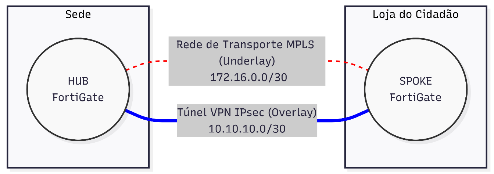
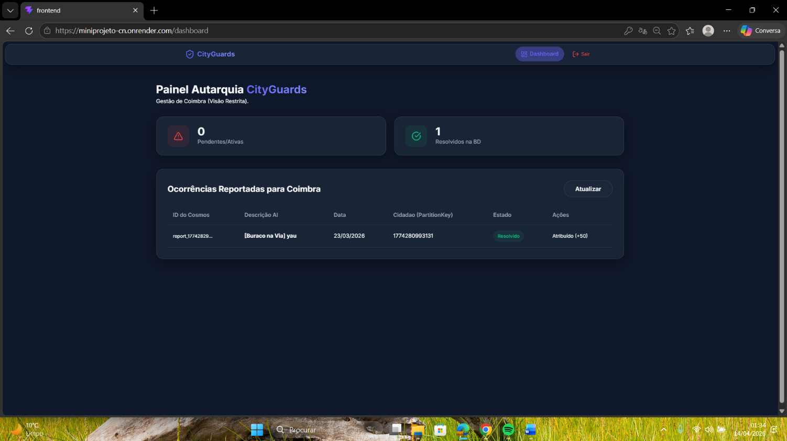

# Rafael Cruz

### 🛡️ Security Automation, NetDevOps & SRE Engineer

🇵🇹 **Portugal** • 🎓 **BSc in Computer Science and Engineering (IPCB · Final Grade: 15 / 20)**  
💼 **Immediate Availability · Eligible for Professional Internship (IEFP Level 6 / ATIVAR.pt)**

  
  
  

---

## 👨‍💻 Executive Summary

Software Engineer focused on **Network Automation (NetDevOps)**, **Multi-Cloud Engineering (SecDevOps)**, and **Site Reliability Engineering (SRE)**. 

Hands-on experience architecting event-driven closed-loop self-healing systems, declarative infrastructure provisioning (IaC), and hardened CI/CD pipelines with federated authentication (Azure OIDC). Driven by reducing **MTTD/MTTR**, eliminating **configuration drift** via Single Source of Truth (**NetBox**), and enforcing operational resilience and **ISO 27001** auditability across mission-critical infrastructures.

Backed by a solid Computer Science foundation in **Object-Oriented Software Architecture (GoF Patterns, Java 17/21, Node.js)** and **Advanced Database Engineering (Neo4j Graph DB Certified, MongoDB, Firestore, MySQL)**, enabling seamless collaboration across both platform operations and core backend application development.

---

## 🔒 Official Technical Certifications

| Issuer | Official Certification Credential | Domain | Status |
|:---|:---|:---:|:---:|
| 🛡️ **Fortinet** | **Fortinet NSE 2 Certified in Cybersecurity** | Network Security | `Active` ● |
| 🛡️ **Fortinet** | **Fortinet NSE 1 Certified in Cybersecurity** | Network Security | `Active` ● |
| ☁️ **Amazon Web Services** | **AWS Academy Graduate — Cloud Operations** | CloudOps & SysOps | `Active` ● |
| ☁️ **Amazon Web Services** | **AWS Academy Graduate — Cloud Security Foundations** | Cloud Security | `Active` ● |
| ☁️ **Amazon Web Services** | **AWS Academy Graduate — Cloud Foundations** | Cloud Architecture | `Active` ● |
| 📊 **Neo4j** | **Neo4j Certified Professional** | Graph Databases | `Active` ● |
| 🔬 **Neo4j** | **Neo4j Graph Data Science Certification** | Graph Analytics & AI | `Active` ● |

---

## 🏛️ Core Engineering Pillars

### 1. 🔄 Networking & NetDevOps (Closed-Loop)
- **Event-Driven Auto-Remediation:** Closed-loop self-healing mitigating *configuration drift* (Gateways, Phase 2 CIDR selectors, Firewall Policies, and Security Associations).
- **Hybrid API & CLI Engine:** Primary patch remediation via **FortiOS REST API** (Token authentication with *Trusted Hosts* restrictions) converging in **4–7 seconds**, with deterministic **Python (Netmiko)** SSH fallback.
- **Single Source of Truth (SSoT):** Declarative golden config reconciliation against **NetBox IPAM/DCIM**.
- **Differential Telemetry:** **PRTG** webhooks with preventive ICMP *Pre-Checks* isolating hardware/electrical loss from logical tunnel faults (**MTTD < 10s, >95% reduction**).

### 2. ☁️ Cloud, IaC & SecDevOps
- **Multi-Cloud Orchestration:** Architecture across **Microsoft Azure, Amazon Web Services (AWS), and Google Cloud Platform (GCP)**.
- **Declarative IaC:** Provisioning with **Azure Bicep** and **Terraform**, using dynamic Connection String and secrets injection.
- **Zero-Secret CI/CD:** GitHub Actions pipelines with federated identity authentication via **Azure OIDC (`azure/login@v2`)** — zero long-lived static secrets.
- **Shift-Left Security:** Automated compliance scanning with **Checkov SAST**, Docker containerization, and data sovereignty compliance (**GDPR vs. US CLOUD Act**).

### 3. 📊 SRE, Observability & Security
- **Fault-Injection Testing:** Rigorous **Chaos Engineering** validation across 24 empirical failure trials.
- **Forensic Auditability:** Syslog event streaming persisted in **MongoDB (Docker)**, high-priority incident notifications via **Telegram Bot**, and MTTR/RCA dashboards in **Metabase** compliant with **ISO 27001**.
- **Security Analysis:** Threat telemetry with **SIEM (Wazuh, Splunk)**, packet inspection via **Wireshark**, cryptography with **OpenSSL**, reconnaissance with **Nmap**, and vulnerability scanning via **OpenVAS**.

---

## ⚡ Tech Stack & Ecosystem

#### ☁️ Cloud, IaC & Security

  
  
  
  
  
  
  
  

#### 🔄 NetDevOps & Network Automation

  
  
  
  
  
  
  

#### 💻 Software Engineering & Data Ecosystem

  
  
  
  
  
  
  
  
  
  
  
  
  

#### 🌐 Languages (Idiomas)
**🇵🇹 Portuguese:** Native &nbsp;|&nbsp; **🇬🇧 English:** Full Professional (C1) &nbsp;|&nbsp; **🇪🇸 Spanish:** Working Operational (B2)

---

## 🚀 Featured Engineering Projects (Dual-Track)

### ☁️ Track A: Cloud Infrastructure, NetDevOps & SRE

### 1. 🌐 NetDevOps Closed-Loop Automation & Network Resilience (PoC)
**Capstone Engineering Project · Grade: 19 / 20 · Industry Partnership: ARTE, I.P.**

*Event-driven closed-loop automation architecture engineered to enhance resilience and availability across critical enterprise hybrid networks (Overlay IPsec VPN over Underlay MPLS).*

  
  
<i>Topology: ARTE, I.P. Hybrid Infrastructure (Hub FortiGate vs. Spoke FortiGate connected via MPLS Underlay and IPsec Overlay)</i>

  
  
<i>Architecture: Macro closed-loop workflow (PRTG Probing ➔ n8n Orchestrator ➔ NetBox SSoT ➔ FortiOS REST API / Netmiko SSH ➔ MongoDB/Metabase)</i>

#### 📊 Measured Operational Metrics
- ⚡ **Convergence Speed:** Configuration drift auto-corrected on FortiOS in **4 to 7 seconds**.
- ⏱️ **MTTR Reduction:** Total closed-loop forensic cycle of **40–70 seconds** (vs. **15–30 minutes** manual resolution).
- 🎯 **MTTD Optimization:** Fault isolated between MPLS underlay and IPsec overlay in **< 10s (>95% reduction)**.
- 🛡️ **Chaos Engineering:** **24/24 empirical failure trials** verified (simulating route tampering, PSK corruption, policy locks, and power outages).
- 📜 **Regulatory Alignment:** Immutable audit logging in MongoDB and SRE dashboards in Metabase aligned with **ISO 27001**.

👉 [**Explore the GitHub Repository →**](https://github.com/RafaCr3z/netdevops-closed-loop-platform) &nbsp;|&nbsp; 👉 [**View Live Interactive Blueprint in Portfolio →**](https://rafacr3z.github.io/portfolio/#projects)

---

### 2. 🛡️ Secure & Resilient Multi-Cloud Platform (CityGuards)
**Cloud Engineering Project · Grade: 20 / 20**

*Distributed civic issue reporting and municipal asset management platform combining Microsoft Azure PaaS and Google Cloud Platform (GCP) with dual graceful degradation.*

  
  
<i>Operational Dashboard: CityGuards running on active hybrid multi-cloud architecture (Azure App Service + GCP Firestore)</i>

#### 📊 Measured Operational Metrics
- 🔐 **Zero-Secret Deployments:** CI/CD via GitHub Actions with federated **Azure OIDC (`azure/login@v2`)** and Checkov SAST scanning.
- ⚡ **ACID Data Integrity:** Decoupled migration to GCP Cloud Firestore with `db.runTransaction` guaranteeing atomic mutations without race conditions.
- 🔄 **Dual Graceful Degradation:**
  - *AI Vision Fallback:* Automated switch to local NLP regex heuristics (`TextHeuristicFallback`) during cognitive API quota pauses.
  - *FinOps PDF Generation:* Dynamic Azure Container Instances (ACI) scaling with instantaneous in-process Node.js fallback.
- ⚖️ **Sovereignty & Governance:** Comprehensive technical compliance analysis regarding **GDPR vs. US CLOUD Act** cross-border reach.

👉 [**Explore the GitHub Repository →**](https://github.com/RafaCr3z/cityguards-platform-core) &nbsp;|&nbsp; 👉 [**View Live Interactive Blueprint in Portfolio →**](https://rafacr3z.github.io/portfolio/#projects)

---

### 💻 Track B: Software Engineering, Backend & Systems

### 3. 🏛️ [PDS Software Design Patterns Monorepo](https://github.com/RafaCr3z/pds-software-design-patterns)
**Architectural Reengineering & Gang of Four (GoF) Patterns in Java 17/21 LTS (EST/IPCB)**

*Monorepo showcasing clean architecture, object-oriented design patterns, and state machine refactoring over complex applications:*
- **EST Global Airways (TP1):** Flight booking and fleet management system built with **Facade**, polymorphic **Factory Method**, and multi-window event-driven Java Swing UI.
- **Banco do FaroEST (TP2):** Arcade game engine reengineering with **State Pattern** (client & door state machines), **Prototype** (deep cloning of entities and levels), **Abstract Factory** (modular expansion packs), **Strategy**, **Template Method**, and thread-safe **Singleton**.
- **Clean Code & SOLID:** Elimination of code smells, replacement of monolithic `switch/case` statements and removal of `instanceof` checks via polymorphic GraphStream rendering.

👉 [**Explore the Design Patterns Monorepo →**](https://github.com/RafaCr3z/pds-software-design-patterns)

 

### 4. 🚌 [FelixBus Travel Platform](https://github.com/RafaCr3z/felixbus-travel-platform)
**Dual-Stack Web Platform (PHP 8 & Java JSP / Tomcat) with Transactional Virtual Wallet**

*Comprehensive passenger transport booking system featuring dual reference implementations sharing a normalized relational database:*
- **Dual-Stack Architectural Comparison:** Native PHP 8.x + Apache HTTPD versus Java JSP / Servlets on Apache Tomcat.
- **Strict Transactional Virtual Wallet:** Atomic balance debits/credits with full transactional audit logging for ticket purchasing.
- **4-Level Role-Based Access Control (RBAC):** Distinct workflows and dashboards for Visitor, Customer, Staff, and Administrator profiles.

👉 [**Explore the FelixBus Platform →**](https://github.com/RafaCr3z/felixbus-travel-platform)

---

## 📈 GitHub Telemetry

---

## 📬 Contact & Open Opportunities

If your organization is seeking an engineer with a strong analytical foundation in **Security Automation**, **NetDevOps**, **SecDevOps**, or **Site Reliability Engineering (SRE)**:

- 💼 **Status:** Immediate Availability · Eligible for Professional Internship (**IEFP Nível 6 / ATIVAR.pt**)
- 📧 **Direct Email:** [rafael.lourenco.cruz20@gmail.com](mailto:rafael.lourenco.cruz20@gmail.com)
- 🌐 **Online Portfolio:** [rafacr3z.github.io/portfolio](https://rafacr3z.github.io/portfolio/)
- 🔗 **LinkedIn Profile:** [linkedin.com/in/rafael-cruz-7159092b2](https://www.linkedin.com/in/rafael-cruz-7159092b2/)

  © 2026 Rafael Cruz · Engineered with deterministic resilience

