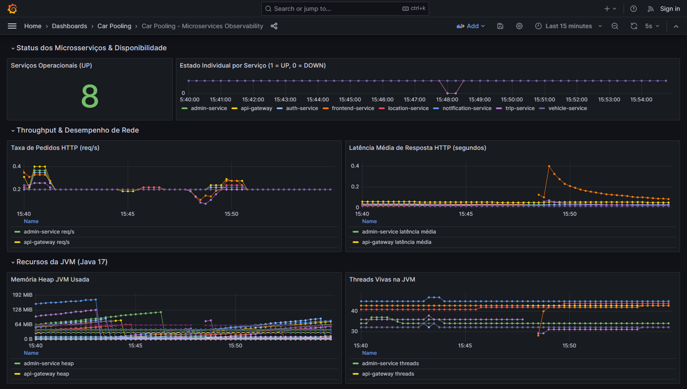

# Rafael Cruz

### Computer Science & Engineering Graduate
#### Networks, Systems, Cloud & Automation | Java / Spring Boot Backend

🇵🇹 **Portugal** • 🎓 **BSc in Computer Science and Engineering (IPCB · Final Grade: 15 / 20)**  
💼 **Immediate Availability (Remote, Hybrid or Relocation) · Eligible for +Talento Internships (IEFP Level 6)**

  
  
  

---

## 👨‍💻 Profile & Overview

Recent Computer Science and Engineering graduate from the Polytechnic Institute of Castelo Branco (IPCB), with a solid foundation and hands-on focus on **Network Automation (NetDevOps)**, **Systems & Multi-Cloud Infrastructure**, and **Backend Software Engineering (Java / Spring Boot)**.

Experienced in developing laboratory prototypes, academic capstones, and architectural proofs-of-concept:
- **NetDevOps & Self-Healing Networks:** Event-driven closed-loop remediation prototypes integrating telemetry, NetBox Single Source of Truth (SSoT), and FortiOS API/SSH automation.
- **Multi-Cloud & SecDevOps:** Declarative IaC (Azure Bicep, Terraform), federated zero-secret CI/CD pipelines (Azure OIDC), and containerized deployments.
- **Distributed Systems & Microservices:** Event-driven architectures with Spring Boot, Spring Cloud, RabbitMQ, Redis, PostgreSQL, and full LGTM observability (Prometheus, Grafana, Tempo, Loki).
- **Software Engineering Foundations:** Object-Oriented Design (GoF Patterns, Java 17/21), relational and graph databases (Neo4j, PostgreSQL, MongoDB, GCP Firestore).

Seeking entry-level opportunities as a **Junior Network Engineer, Junior Cloud / DevOps / SRE Engineer, or Junior Backend Developer**.

---

## 📜 Certifications & Academic Credentials

### Official Industry Certifications

| Issuer | Certification | Domain | Status |
|:---|:---|:---:|:---:|
| 🛡️ **Fortinet** | **Fortinet NSE 2 Certified in Cybersecurity** | Network Security | `Active` ● |
| 🛡️ **Fortinet** | **Fortinet NSE 1 Certified in Cybersecurity** | Network Security | `Active` ● |
| 📊 **Neo4j** | **Neo4j Certified Professional** | Graph Databases | `Active` ● |
| 🔬 **Neo4j** | **Neo4j Graph Data Science Certification** | Graph Analytics | `Active` ● |

### Academic & Course Training Credentials

| Provider | Credential | Focus Area |
|:---|:---|:---|
| ☁️ **Amazon Web Services** | **AWS Academy Graduate — Cloud Operations** | CloudOps, Systems & Administration |
| ☁️ **Amazon Web Services** | **AWS Academy Graduate — Cloud Security Foundations** | Cloud Security & Compliance |
| ☁️ **Amazon Web Services** | **AWS Academy Graduate — Cloud Foundations** | Multi-Tier Cloud Architectures |

---

## 🛠️ Core Engineering Skills

- **Networking & Automation:** IPsec VPN, MPLS Underlay, FortiOS REST API & CLI automation, Python (Netmiko, Requests), NetBox IPAM/DCIM, PRTG Network Monitor, Wireshark, n8n.
- **Cloud & DevOps:** Microsoft Azure, AWS, GCP, Azure Bicep, Terraform, Docker, Docker Compose, Kubernetes (declarative Kustomize manifests), GitHub Actions CI/CD with Azure OIDC, Trivy.
- **Backend & Distributed Systems:** Java 17/21 LTS, Spring Boot 3, Spring Cloud (Eureka, Gateway, OpenFeign), RabbitMQ (Topic Exchange, DLQ), Redis 7 (Cache-Aside, Rate Limiting), Node.js / TypeScript, Python 3, PHP 8.
- **Observability & Databases:** Prometheus, Grafana, Grafana Tempo (OTLP Tracing), Grafana Loki (Centralized Logging), PostgreSQL (Database-per-Service, Flyway), MongoDB, GCP Firestore, Neo4j Graph DB.
- **Languages:** Portuguese (Native), English (Full Professional — C1), Spanish (Advanced Intermediate — B2).

---

## 🚀 Featured Engineering Projects

### 1. 🌐 NetDevOps Closed-Loop Automation & Network Resilience (PoC)
**Capstone Engineering Project (Projeto I & II) · Final Grade: 19 / 20 · Partnership: ARTE, I.P. (Decreto-Lei n.º 96/2025, ex-AMA) · Sep 2025 – Aug 2026 · Team: Rafael Cruz & Rafael Victorino · Industry Mentorship: Eng.º Nuno Batuca (ARTE, I.P.) · Supervisors: Prof. Dr. Vasco Soares & Prof. Dr. Alexandre Fonte**

*Two-part capstone engineering project (*Automação e Inteligência em Redes de Comunicação de Dados: integração da metodologia Network DevOps numa arquitetura de redes híbrida*) evolving from passive granular diagnostics (Projeto I) to active closed-loop self-healing (Projeto II) across Hub-and-Spoke government WANs (Overlay IPsec IKEv2 VPN over Underlay MPLS).*

  
  
<i>Closed-Loop Architecture: PRTG Telemetry ➔ n8n Orchestrator ➔ NetBox SSoT ➔ FortiOS REST API / Netmiko SSH ➔ MongoDB & Metabase BI</i>

#### Key Highlights & Empirical Findings:
- **Two-Phase Remediation Engine (Projeto II):** **Phase 1 (Trial Contingency)** uses isolated Python/`Netmiko` SSH scripts (`/opt/venv_netmiko` under **Ubuntu Server 24.04 PEP 668**); **Phase 2 (Enterprise)** uses synchronous **HTTPS `PUT`/`POST` calls** against the **FortiOS v7.6.4 CMDB REST API** (API Token + Trusted Hosts `10.0.0.60`), achieving transactional efficiency $\mathcal{R}_{\text{trans}} \ge 90\%$ (< 2s CMDB injection) and adding **Firewall Policy (`policy_disabled`)** auditing.
- **Active Remediation & Syslog Convergence:** FortiOS v7.6.4 syslogs in **VMware Workstation Pro** document active recovery and IKEv2/IPsec tunnel convergence in **4 to 7 seconds** (`15:47:55`→`15:47:59` [4s] for `rgwy_mismatch`; `15:58:23`→`15:58:30` [7s] for `phase2_mismatch`; `15:40:43`→`15:40:50` [7s] for `zero_traffic`), reducing full-cycle MTTR from 15–30 minutes (manual) to ~60s (including 12s/35s stabilization re-checks).
- **Differential Fault Isolation (MTTD):** Isolates underlay MPLS carrier outages (`mpls_down` → automated SMTP escalation via Mailtrap) and branch power blackouts (**Pre-Check ICMP** `exitCode != 0` on `172.16.0.2` → write suppression + Telegram alert) in **< 10s** (>95% MTTD reduction in Projeto I; **< 1s** via PRTG Webhooks in Phase 2).
- **10 Lab Chaos Scenarios (A–J) & 24 Recorded Incidents:** Validated across **10 Chaos Engineering scenarios** in VMware Workstation Pro, generating **24 forensic incident documents in MongoDB** (`13` in Phase 1 `incident_runs` [53.8% `auto_recovered`, 30.8% `escalated_to_provider`, 15.4% `power_or_hardware_failure`] + `11` in Phase 2 `incident_runs_enterprise` [72.7% `auto_recovered`, 27.3% `not_attempted`]), analyzed in **Metabase BI** alongside an offline 24-scenario synthetic benchmark script (`scripts/chaos_simulation_demo.py`).

👉 [**GitHub Repository →**](https://github.com/RafaCr3z/netdevops-closed-loop-platform) &nbsp;|&nbsp; 👉 [**Interactive Blueprint in Portfolio →**](https://rafacr3z.github.io/portfolio/#projects)

---

### 2. 🛡️ Secure Multi-Cloud Municipal Platform (CityGuards)
**Academic Project · Final Grade: 20 / 20 · Feb 2026 – May 2026 · Team: Diogo Oliveira, Rafael Cruz, Tiago Alves · Supervisor: Prof. Osvaldo Santos**

*Multi-cloud civic reporting and municipal asset management prototype leveraging Microsoft Azure PaaS and Google Cloud Platform (GCP) with automated failover and graceful degradation.*

  
  
<i>CityGuards Architecture: Azure App Service / Static Web Apps paired with GCP Cloud Firestore and cognitive AI fallback</i>

#### Key Highlights & Team Scope:
- **Zero-Secret CI/CD (Post-Coursework Evolution):** GitHub Actions workflow authenticated via federated **Azure OIDC (`azure/login@v2`)**, eliminating long-lived credentials in GitHub Secrets.
- **Infrastructure as Code (IaC):** Modular **Azure Bicep** templates (original academic IaC authored by teammate **Tiago Alves**; adapted for automated CI `az bicep build` validation in the published repository).
- **ACID Transactional Persistence (Rafael Cruz):** Atomic incident state transitions and persistence layer implemented with **GCP Cloud Firestore** transactions (`db.runTransaction`) to eliminate concurrent status conflicts.
- **Graceful Degradation & FinOps:** Local regex heuristic fallback during cognitive AI API pauses, containerized PDF report generation (`pdf-service` Dockerized by Rafael Cruz) via Azure Container Instances (ACI), and cloud cost optimized to **~72 €/month** (evaluating European sovereign alternatives vs. US CLOUD Act).
- **Container Hardening:** Multi-stage Docker containerization with non-root security context and Trivy security scans.

👉 [**GitHub Repository →**](https://github.com/RafaCr3z/cityguards-platform-core) &nbsp;|&nbsp; 👉 [**Interactive Blueprint in Portfolio →**](https://rafacr3z.github.io/portfolio/#projects)

---

### 3. 🚗 CarPooling PT — Distributed Microservices Platform
**Personal Engineering Project · Author: Rafael Cruz**

*Distributed car-pooling and sustainable mobility prototype built with Spring Boot 3, Spring Cloud, and cloud-native observability patterns.*

  
  
<i>Observability Cockpit: Real-time JVM, request rate, and latency metrics visualized in Grafana with Prometheus scrape targets</i>

#### Key Highlights & Technical Metrics:
- **Modular Microservices Architecture:** **11 Maven modules** (1 shared contract library `common-lib` + 10 Spring Boot microservices: Eureka, Gateway, Auth, Trip, Vehicle, Payment, Location, Notification, Admin, Frontend).
- **Containerized Ecosystem:** **18 Docker containers** defined in `docker-compose.yml` (10 application services, 3 core data stores — PostgreSQL, RabbitMQ, Redis —, and 5 observability containers: Prometheus, Grafana, Tempo, Loki, Promtail; optional 15-container lightweight mode via `--scale tempo=0 --scale loki=0 --scale promtail=0`).
- **Automated Test Suite:** **123 automated unit and sliced integration tests** (JUnit 5 + Mockito) executed via Maven Reactor with 100% pass rate in CI.
- **Reliability & Event-Driven Decoupling:** RabbitMQ Topic Exchange with Dead Letter Queue (`notification.dlq`) and exponential backoff retry; Resilience4j Circuit Breakers with fallback handlers; Redis Cache-Aside for geocoding and Token Bucket rate limiting.
- **Payment Sandbox:** Idempotent payment processing simulated for MBWay, Card, and Wallet transactions (synthetic validation without external payment gateway).
- **Cloud-Native & DevSecOps:** Declarative Kubernetes manifests validated via `kubectl kustomize k8s/`; filesystem vulnerability scanning with Trivy pinned action and documented `.trivyignore` exemptions.

👉 [**GitHub Repository →**](https://github.com/RafaCr3z/car-pooling-platform) &nbsp;|&nbsp; 👉 [**Interactive Blueprint in Portfolio →**](https://rafacr3z.github.io/portfolio/#projects)

---

## 📚 Other Academic & Foundation Projects

<b>Click to expand secondary software engineering repositories</b>

 

### 🏛️ [PDS Software Design Patterns Monorepo](https://github.com/RafaCr3z/pds-software-design-patterns)
*Academic coursework in Java 17/21 LTS demonstrating Gang of Four (GoF) structural, creational, and behavioral patterns:*
- **EST Global Airways:** Flight management system using Facade and Factory Method patterns with a Swing interface.
- **Banco do FaroEST:** Arcade game engine refactored with State Pattern (state machines), Prototype (deep entity cloning), Abstract Factory, Strategy, and thread-safe Singleton.
- **Refactoring:** Elimination of anti-patterns, reduction of cyclomatic complexity, and polymorphic rendering.

### 🚌 [FelixBus Travel Platform](https://github.com/RafaCr3z/felixbus-travel-platform)
*Passenger transport management system developed in two distinct backend stacks over a shared relational database:*
- **Dual Implementation:** Comparative study between PHP 8.x + Apache HTTPD and Java JSP / Servlets on Apache Tomcat.
- **Virtual Wallet:** Transactional ledger for passenger balance and ticket booking.
- **Role-Based Access Control:** Role hierarchy covering Visitor, Customer, Staff, and Admin workflows.

---

## 📈 GitHub Telemetry

---

## 📬 Contact & Availability

- 💼 **Status:** Immediate Availability · Eligible for Professional Internship (**IEFP Nível 6 / +TALENTO**)
- 📧 **Direct Email:** [rafael.lourenco.cruz20@gmail.com](mailto:rafael.lourenco.cruz20@gmail.com)
- 🌐 **Online Portfolio:** [rafacr3z.github.io/portfolio](https://rafacr3z.github.io/portfolio/)
- 🔗 **LinkedIn:** [linkedin.com/in/rafael-cruz-7159092b2](https://www.linkedin.com/in/rafael-cruz-7159092b2/)

  © 2026 Rafael Cruz · Computer Science and Engineering

